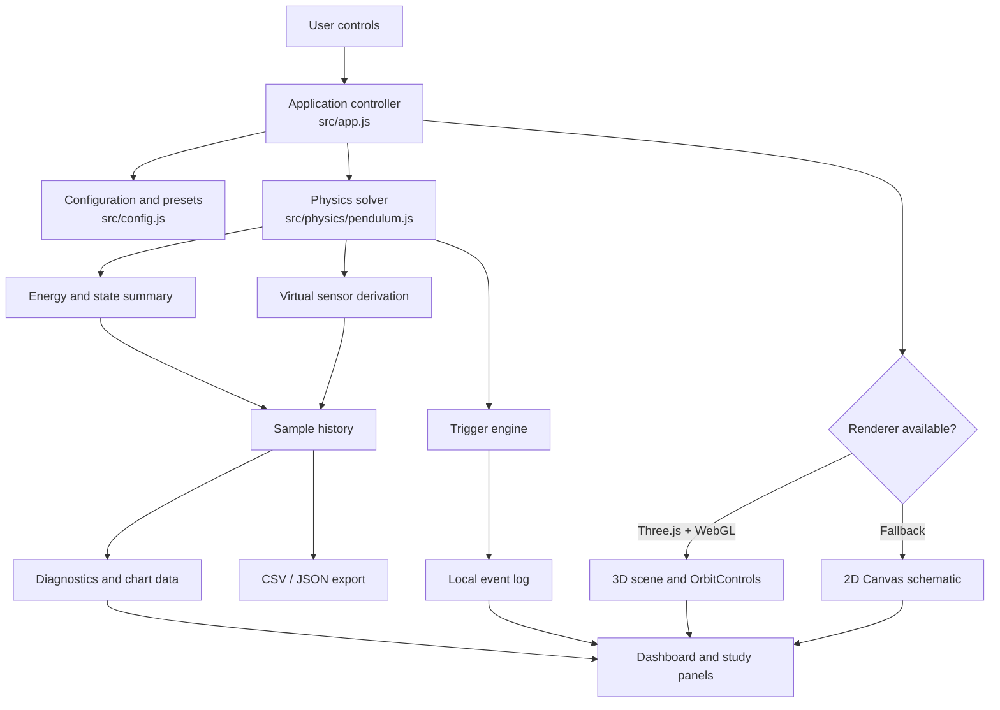
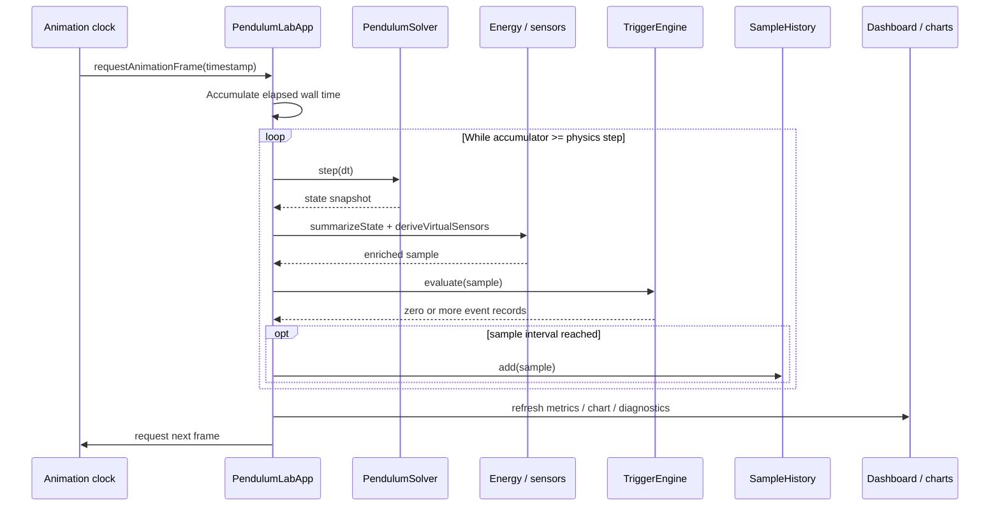
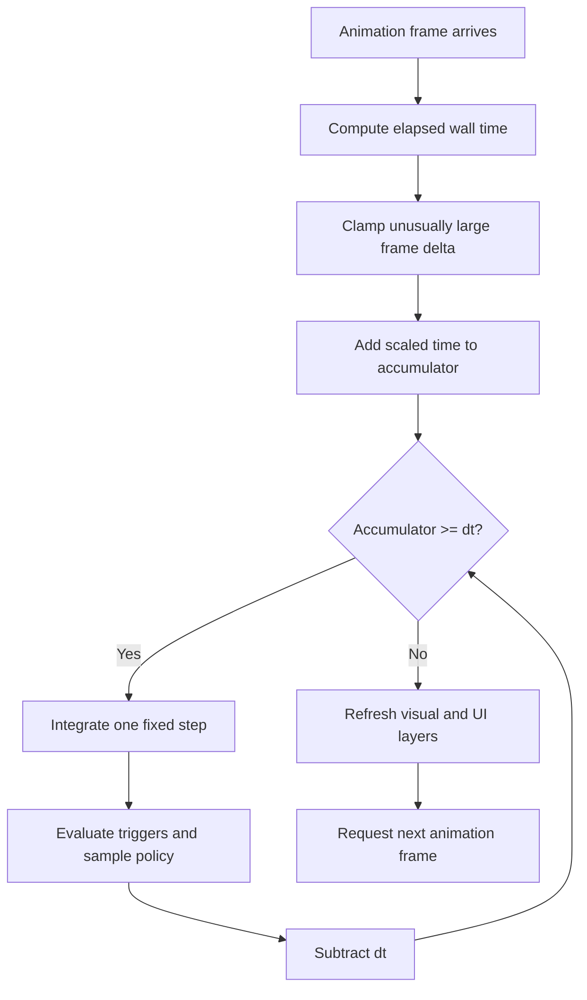
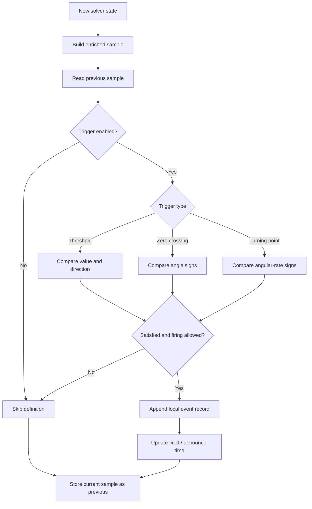
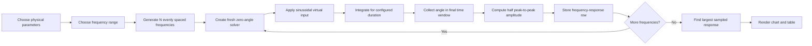

# A.T.T.E.D.N.E.V. — Angular Trajectory Tracking & Energy Dynamics Numerical Experiment Visualizer (The-Pendulum-Trap-A-3D-AutoCAD-Modeling)

> **A browser-based 3D pendulum physics laboratory for simulation, numerical-method comparison, virtual event monitoring, and experiment data export.**
>
> **Version:** 2.0.0  
> **Runtime:** modern browser + native JavaScript ES modules  
> **Physics units:** SI  
> **Scope:** software-only educational simulation; no hardware control or physical actuator outputs

[](#project-status)
[](#technology-stack)
[](#automated-tests)
[](#license)

.png?raw=true)
---

## Table of contents

1. [Project overview](#1-project-overview)
2. [System architecture](#2-system-architecture)
3. [Physical model and assumptions](#3-physical-model-and-assumptions)
4. [Equations, energy, and diagnostics](#4-equations-energy-and-diagnostics)
5. [Numerical integration and simulation clock](#5-numerical-integration-and-simulation-clock)
6. [Virtual triggers and sensor channels](#6-virtual-triggers-and-sensor-channels)
7. [3D visualization and user interface](#7-3d-visualization-and-user-interface)
8. [Experiments and response analysis](#8-experiments-and-response-analysis)
9. [Data model, exports, and reproducibility](#9-data-model-exports-and-reproducibility)
10. [Installation, testing, deployment, and extension](#10-installation-testing-deployment-and-extension)
11. [Limitations and responsible use](#limitations-and-responsible-use)
12. [Repository map](#repository-map)
13. [References and terminology](#references-and-terminology)


---

# 1. Project overview

## 1.1 What this project does

ATTEDNEV Pendulum Dynamics Lab is an interactive engineering-style web application for exploring the motion of an idealized pendulum. The browser solves a nonlinear equation of motion, renders the result as a three-dimensional scene, records sampled state variables, evaluates configurable software events, and produces charts and experiment files.

The application combines five technical layers:

- **Dynamics:** a nonlinear, single-degree-of-freedom pendulum with linear angular damping and optional sinusoidal virtual excitation.
- **Numerical methods:** four fixed-step integration schemes with selectable physics rates.
- **Event monitoring:** threshold, equilibrium-crossing, and turning-point conditions evaluated against simulated state.
- **Visualization:** a Three.js scene with orbit controls, path history, a velocity vector, and a 2D Canvas fallback.
- **Analysis and data:** response plots, energy and period diagnostics, a frequency sweep, a convergence comparison, and CSV/JSON downloads.

The simulation is designed to be inspectable. The model equations and their units are documented, the physics modules can be imported independently of the DOM, and the Node test suite exercises key mathematical properties.

## 1.2 Main capabilities

| Area | Capability | Implementation |
|---|---|---|
| 3D model | Pendulum, support reference, orbit camera, trail, velocity vector | `src/visual/scene.js` |
| Fallback | 2D canvas schematic when Three.js/WebGL setup fails | `src/visual/fallback.js` |
| Dynamics | Nonlinear angle/rate state equation | `src/physics/pendulum.js` |
| Solver choices | RK4, semi-implicit Euler, explicit Euler, split damped Verlet | `src/physics/pendulum.js` |
| Playback | Run, pause, reset, single-step, playback scaling | `src/app.js` |
| Virtual events | Angle, angular-rate, energy, elapsed-time, zero-crossing, turning point | `src/physics/triggers.js` |
| Diagnostics | Natural frequency, small-angle period, damping ratio, observed period, RMS angle, energy change | `src/physics/analysis.js` |
| Studies | Driven frequency sweep and step-size convergence comparison | `src/physics/sweeps.js`, `src/physics/convergence.js` |
| Data | Bounded in-memory history, CSV samples, JSON experiment bundle | `src/physics/history.js`, `src/app.js` |

## 1.3 Typical learning workflow

A useful first experiment is to load the baseline configuration, run the pendulum, and observe angle, angular rate, and total energy. Then vary one parameter at a time. For example, increase damping while holding length and gravity constant; compare the observed period with the small-angle theoretical period; or load the driven-response preset and run a frequency sweep.

A controlled workflow is:

1. Choose a preset or set the physical parameters.
2. Select a numerical integrator and integration rate.
3. Reset the system so the recorded run has a known initial condition.
4. Run or single-step the simulation.
5. Inspect live values, charts, event records, and diagnostics.
6. Run a frequency sweep or convergence study when appropriate.
7. Export the samples and experiment metadata.
8. Repeat with one changed parameter and compare the exported runs.

## 1.4 Project status

Version 2.0.0 is a browser-based educational simulator. The bundled physics suite contains 12 automated tests. A static source audit and JavaScript syntax checks were performed for the packaged project. Full cross-browser interactive QA should still be performed after deployment; passing numerical tests does not establish that every browser, GPU, or hosted environment renders identically.

---

# 2. System architecture

## 2.1 Layered design

The application separates the mathematical model from the browser interface. The solver does not import Three.js or access the DOM. The UI layer reads the solver state and sends configuration changes back to the application controller. The renderer receives state snapshots and maps them to a visual pose.



The chart and renderer are intentionally downstream of the solver. Changing a screen refresh rate does not directly change the numerical step size. A run may therefore perform several physics steps before drawing one visible frame.

## 2.2 Runtime responsibilities

### Application controller — `src/app.js`

`PendulumLabApp` owns the high-level simulation lifecycle. It creates the solver, trigger engine, history buffer, visualization, chart, dashboard, controls, and study panels. It also:

- handles run/pause/reset/single-step actions;
- manages the fixed-step accumulator;
- calls the solver and derives sample fields;
- evaluates event conditions on each physics step;
- writes samples to bounded history;
- refreshes charts and dashboard metrics;
- orchestrates study runs and browser downloads.

### Physics layer — `src/physics/`

This layer contains deterministic functions and stateful model classes. It can run in Node.js tests without creating a browser window. It is the best place to add or validate a new mathematical quantity before connecting it to a UI element.

### Presentation layer — `src/ui/` and `src/visual/`

The UI modules bind controls and render values. `ResponseChart` and `StudyPanels` draw charts into Canvas elements. `PendulumScene` uses Three.js for the 3D scene; `CanvasPendulumScene` provides a lower-feature 2D fallback.

## 2.3 Simulation data flow

Each integration step produces a fresh state snapshot. The controller enriches it with energy, momentum, acceleration, and virtual sensor values. The trigger engine evaluates this current sample, while the history buffer stores samples at the selected sampling interval. This distinction matters: trigger checks are not restricted to chart samples.



## 2.4 Configuration and defaults

`src/config.js` defines version metadata, frame-loop limits, history capacity, trigger debounce interval, default physical parameters, presets, and trigger definitions.

Default model parameters:

| Parameter | Default | Unit | Meaning |
|---|---:|---|---|
| `length` | 2.4 | m | Pivot-to-bob distance |
| `mass` | 8 | kg | Point-mass bob value used for energy and momentum |
| `gravity` | 9.81 | m/s² | Gravitational field strength |
| `damping` | 0.025 | s⁻¹ | Linear angular damping coefficient |
| `initialAngleDeg` | 35 | ° | Initial angular displacement from downward vertical |
| `driveAmplitude` | 0 | rad/s² | Virtual angular-acceleration input amplitude |
| `driveFrequencyHz` | 0.65 | Hz | Virtual sinusoidal input frequency |
| `drivePhaseDeg` | 0 | ° | Virtual input phase |
| `integrator` | `rk4` | — | Numerical method |
| `sampleInterval` | 1/60 | s | Data-recording interval |

The numerical integration step defaults to `1/120 s` (120 Hz). This is separate from the sample interval, which defaults to 60 Hz. The application can integrate at 120 Hz while recording data at 60 Hz.

---

# 3. Physical model and assumptions

## 3.1 Model definition

The physical model is a planar pendulum represented by a point mass at the end of a rigid, massless rod. The rod length is constant. The pivot is fixed. Motion is restricted to one plane and described by one generalized coordinate, angular displacement `θ`.

The angle is measured from the **downward vertical**:

- `θ = 0` is the lowest equilibrium position;
- positive and negative angles represent opposite sides of the equilibrium line;
- `ω = dθ/dt` is angular velocity;
- `α = d²θ/dt²` is angular acceleration.

The visual support frame is only a generic scene reference. It is not a structural engineering model, manufacturing drawing, or load-rated support specification.

## 3.2 Free-body and sign convention diagram

The diagram below describes the idealized bob. Gravity acts vertically downward. The rod constrains the bob to a circular path. Gravity contributes a restoring torque about the pivot; damping opposes angular velocity. The optional drive is a virtual generalized angular-acceleration term.

```text
                 fixed pivot O
                       ●
                       |\
       downward       | \  rigid, massless rod (L)
       vertical       |θ \
          ↓           |   \
          |           |    ●  bob (mass m)
          |           |    ↓  mg
          |                ↙
          |          tangential direction

Angle θ is measured from the downward vertical.
Gravity produces restoring torque about O.
Linear damping opposes angular velocity ω.
```

For a point mass, the moment of inertia about the pivot is

$$I = mL^2.$$

The gravitational torque magnitude is `mgL sin(θ)` and its sign is restoring for the chosen convention. The model's linear damping torque is represented as `-I c ω`. The virtual drive is expressed as an angular-acceleration input, so its equivalent generalized torque is `I A sin(2πft + φ)`.

## 3.3 Governing equation

Applying rotational dynamics about the pivot and dividing by `I` gives:

$$\boxed{\ddot{\theta} + c\dot{\theta} + \frac{g}{L}\sin\theta = A\sin(2\pi f t + \phi)}$$

or, in explicit acceleration form used by the solver:

$$\boxed{\alpha = -\frac{g}{L}\sin\theta - c\omega + A\sin(2\pi f t + \phi)}$$

When `A = 0`, the model is a free damped pendulum. When `A > 0` and `f > 0`, the model includes an externally prescribed mathematical input. The input is not connected to a motor, actuator, sensor, physical mechanism, or external device.

## 3.4 Model assumptions

| Assumption | Consequence |
|---|---|
| Point-mass bob | All mass is concentrated at the bob center. |
| Massless, rigid rod | Rod inertia, flexibility, bending, and extension are ignored. |
| Fixed pivot | Pivot translation and compliance are ignored. |
| Planar motion | Out-of-plane motion and torsion are ignored. |
| Constant gravity | `g` does not vary with time or position. |
| Linear angular damping | Damping torque is proportional to angular rate. |
| No contact or impacts | No collision, stop, impact, or contact mechanics are modeled. |
| Prescribed sinusoidal input | The drive does not respond to the simulated system or hardware. |

Mass cancels from the ideal equation of motion because both gravitational torque and point-mass rotational inertia scale linearly with `m`. Mass still affects kinetic energy, potential energy, and angular momentum.

## 3.5 Coordinate mapping

The solver returns a planar bob location relative to the pivot:

$$x = L\sin\theta, \qquad y = -L\cos\theta.$$

The Three.js scene offsets the vertical coordinate by its visual pivot height. The renderer maps the abstract state to a pose; it does not feed geometric or collision forces back into the physics solver.

---

# 4. Equations, energy, and diagnostics

## 4.1 State representation

The solver is a two-state ordinary differential equation:

$$\mathbf{x} = \begin{bmatrix}\theta\\\omega\end{bmatrix}, \qquad \dot{\mathbf{x}} = \begin{bmatrix}\omega\\\alpha(\theta,\omega,t)\end{bmatrix}.$$

The implementation stores `theta` in radians, `omega` in radians per second, and simulation time in seconds. The user interface may display degrees, but the physics calculations use radians.

## 4.2 Energy terms

The zero of gravitational potential energy is set at the lowest point of the trajectory.

$$T = \frac{1}{2}m(L\omega)^2 = \frac{1}{2}mL^2\omega^2$$

$$V = mgL(1-\cos\theta)$$

$$E = T + V$$

The corresponding height above the lowest point is

$$h = L(1-\cos\theta).$$

`src/physics/energy.js` calculates kinetic energy, potential energy, total mechanical energy, height, angular momentum, and tangential acceleration. These derived values are added to the solver snapshot for the dashboard and exports.

## 4.3 Energy balance interpretation

Differentiate the mechanical energy with respect to time and substitute the equation of motion:

$$\frac{dE}{dt} = mL^2\omega\left(\alpha + \frac{g}{L}\sin\theta\right)$$

$$\boxed{\frac{dE}{dt} = -mL^2c\omega^2 + mL^2A\omega\sin(2\pi ft+\phi)}$$

This result is a useful diagnostic:

- with no damping and no drive, ideal mechanical energy is constant;
- with positive damping and no drive, the energy derivative is non-positive;
- with virtual excitation, energy may increase or decrease depending on the phase relationship between angular velocity and the input.

Therefore, the dashboard reports a **signed energy change** rather than assuming every run must lose energy. When the initial energy is effectively zero, percent change relative to the initial value is undefined and the display can show a dash.

## 4.4 Frequency and damping diagnostics

For the small-angle approximation `sin(θ) ≈ θ`, the undamped natural angular frequency is

$$\omega_n = \sqrt{\frac{g}{L}}$$

and the small-angle period is

$$T_n = 2\pi\sqrt{\frac{L}{g}}.$$

The app computes the linearized damping ratio as

$$\zeta = \frac{c}{2\omega_n}.$$

These are linearized reference values. At larger angular amplitudes, the full nonlinear pendulum period differs from the small-angle result. In particular, the ideal undamped pendulum's period increases with amplitude.

The observed period diagnostic uses positive-going zero crossings in the recorded samples. Consecutive positive-going crossings span one cycle. Linear interpolation between adjacent samples estimates each crossing time. The displayed measured period is the mean of the measured cycle intervals available in the stored history.

The RMS angle is calculated from recorded angle samples in degrees:

$$\theta_{\mathrm{RMS}} = \sqrt{\frac{1}{N}\sum_{i=1}^{N}\theta_{i,\mathrm{deg}}^2}.$$

## 4.5 Virtual acceleration channels

For a bob moving on a circular path, the scalar radial acceleration magnitude is

$$a_r = L\omega^2$$

and the signed tangential acceleration is

$$a_t = L\alpha.$$

The resultant scalar magnitude is

$$a_{\mathrm{resultant}} = \sqrt{a_r^2 + a_t^2}.$$

The virtual sensor module derives these from the simulated state. It does not model sensor noise, bias, latency, quantization, calibration, saturation, or a real sensor's coordinate alignment unless such behavior is added as a separate software model.

---

# 5. Numerical integration and simulation clock

## 5.1 Fixed-step integration

The solver advances the physical state by a configured, positive step `dt`. The default is `1/120 s`, and the interface supports 30, 60, 120, 240, and 480 Hz. The corresponding steps are:

| Integration rate | Step `dt` |
|---:|---:|
| 30 Hz | 0.0333333 s |
| 60 Hz | 0.0166667 s |
| 120 Hz | 0.0083333 s |
| 240 Hz | 0.0041667 s |
| 480 Hz | 0.0020833 s |

The numerical rate is independent of the data sampling interval and browser display refresh rate.

## 5.2 Available integration methods

### Classical fourth-order Runge–Kutta (RK4)

RK4 evaluates the derivative four times per step, including intermediate state and time estimates:

$$k_1 = f(x_n,t_n)$$

$$k_2 = f(x_n+\tfrac{dt}{2}k_1,t_n+\tfrac{dt}{2})$$

$$k_3 = f(x_n+\tfrac{dt}{2}k_2,t_n+\tfrac{dt}{2})$$

$$k_4 = f(x_n+dt\,k_3,t_n+dt)$$

$$x_{n+1}=x_n+\frac{dt}{6}(k_1+2k_2+2k_3+k_4).$$

It is the default general-purpose method in this project. Evaluating the sinusoidal drive at intermediate stage times helps represent its time dependence within the step.

### Explicit Euler

$$x_{n+1}=x_n+dt\,f(x_n,t_n).$$

This method is simple and useful for comparison, but can exhibit substantial numerical error or energy drift for oscillatory systems, particularly with coarse steps.

### Semi-implicit Euler

The implementation first updates angular velocity, then uses the updated velocity to update angle:

$$\omega_{n+1}=\omega_n+dt\,\alpha(\theta_n,\omega_n,t_n)$$

$$\theta_{n+1}=\theta_n+dt\,\omega_{n+1}.$$

It is a common simple integrator for mechanical systems and can behave differently from explicit Euler in long-term energy response.

### Split damped velocity Verlet

The Verlet option applies an exponential half-step for linear damping around a conservative kick-drift-kick update. The conservative acceleration includes gravity and the virtual drive at the interval endpoints. This is a split approximation tailored to the implemented damping structure; it should not be assumed to be a universal high-order integrator for arbitrary dissipative models.

## 5.3 Browser animation clock

The application uses `requestAnimationFrame` to schedule display updates. Wall-clock frame differences are accumulated, then the solver is advanced in fixed increments while the accumulator contains at least one physics step.



The project limits unusually large frame deltas and caps the number of physics substeps processed in one display frame. This protects the interface from an unbounded catch-up burst after a delayed frame. Under sustained overload, simulation time may lag wall time; the app favors a bounded interactive workload over attempting unlimited catch-up.

Playback speed scales accumulated simulation time. It does **not** change `dt`, the physical model, or the numerical integration method.

## 5.4 Convergence study

The convergence study runs the currently selected solver method at a sequence of step sizes, using a common final simulation time. It compares the final angle and angular velocity against the run using the finest configured step (480 Hz by default).

This is a comparison against a **numerical reference**, not an exact analytical solution. A finer reference can still contain numerical error. Convergence is most useful when:

- the initial condition and physical parameters are identical across runs;
- the chosen step sizes align to the same final time;
- the reference run is sufficiently resolved;
- the error metric and selected solver are recorded with the results.

---

# 6. Virtual triggers and sensor channels

## 6.1 Trigger engine purpose

The trigger engine is an in-memory software condition monitor. It evaluates simulated values and creates event records for the dashboard. It does not issue machine commands, communicate with physical controllers, actuate anything, or implement a safety interlock.

## 6.2 Available trigger definitions

| Trigger | Signal | Default condition | Default repeat behavior |
|---|---|---|---|
| Angular displacement | `abs(angleDeg)` | at or above 25° | One-shot |
| Angular speed | `abs(omega)` | at or above 1.50 rad/s | One-shot |
| Mechanical energy | `total` | at or below 10 J | One-shot |
| Elapsed time | `time` | at or above 5 s | One-shot |
| Center crossing | Sign of `theta` | crosses `theta = 0` | Repeat with debounce |
| Turning point | Sign of `omega` | angular rate changes sign | Repeat with debounce |

The UI allows threshold events to be enabled or disabled and their threshold values to be changed. Crossing and turning-point events detect a state transition between adjacent integration samples.

## 6.3 Trigger evaluation logic

For threshold triggers, the engine compares the relevant scalar value with the configured threshold and direction. Non-repeating definitions fire once until reset or reconfiguration. Repeating definitions can fire again after the debounce interval. The default debounce is 0.35 seconds.

For zero-crossing detection, the engine checks whether angle changes sign between the previous and current integration states. For turning points, it checks whether angular velocity changes sign. Because these are transition-based tests, the first evaluated sample cannot produce a crossing event without a previous sample.



## 6.4 Event record structure

Each event contains:

| Field | Description |
|---|---|
| `id` | Stable trigger identifier |
| `name` | Human-readable event title |
| `kind` | Trigger category |
| `time` | Simulation time when evaluated as fired, in seconds |
| `value` | Measured signal value |
| `threshold` | Numeric threshold, or `null` for transition triggers |
| `message` | Display-ready event description |

The visible event log is capped at 300 records to keep the session bounded. JSON export includes the event records retained at export time.

## 6.5 Virtual sensor channels

`src/physics/sensors.js` derives ideal channels from the simulated state:

- angle sensor: angle in degrees;
- rate gyro: angular velocity in rad/s;
- bob speed: tangential speed in m/s;
- radial acceleration magnitude: `Lω²`;
- tangential acceleration: `Lα`;
- resultant acceleration magnitude;
- drive angular acceleration and its corresponding tangential contribution.

These channels are calculated values, not measurements from physical instruments. They are intended for data-model demonstrations and visualization.

---

# 7. 3D visualization and user interface

## 7.1 Three.js scene

The primary view is created by `src/visual/scene.js`. It uses Three.js 0.170.0 and the matching `OrbitControls` module loaded through the import map in `index.html`.

The visible scene includes:

- a generic frame and top support reference;
- a pivot and pendulum rod;
- a spherical bob;
- a ground grid and coordinate axes;
- a bounded visual trail of recent bob positions;
- an optional tangent velocity arrow;
- perspective camera controls and lighting.

The model is planar even though the scene is rendered in 3D. The camera can orbit and zoom to inspect the geometry, but there is no out-of-plane physical degree of freedom.

## 7.2 Renderer fallback

At startup, `src/main.js` attempts to dynamically import the Three.js scene. If the import or WebGL renderer setup fails, it creates `CanvasPendulumScene` from `src/visual/fallback.js` instead. The fallback draws a two-dimensional schematic using the same angle and length state.

The fallback is intentionally simpler: it keeps the pendulum visible and updates its position, but it does not reproduce all 3D lighting, camera, or trail features. A browser still needs to serve the site over HTTP/HTTPS so native ES modules can load correctly.

## 7.3 Main interface controls

| Control | Effect |
|---|---|
| Run / Pause | Starts or pauses the fixed-step simulation |
| Reset | Restores the initial state and clears the current run history and studies |
| Step 1 frame | Advances one numerical integration interval |
| Playback speed | Scales simulation-time accumulation from the wall clock |
| Camera home | Restores the default scene camera |
| Grid toggle | Shows or hides the reference grid |
| Velocity vector toggle | Shows or hides the tangent velocity arrow |
| Chart tabs | Selects angle, angular velocity, or total energy |
| Preset selector | Applies a predefined physical configuration |
| Solver selector | Selects one of the four numerical methods |
| Integration rate | Selects the fixed numerical step rate |
| Sampling interval | Selects how frequently samples are stored |
| Trigger controls | Enables/disables triggers and edits threshold values |
| Export buttons | Downloads CSV samples or a JSON experiment bundle |

The Space key toggles run/pause when the user is not typing in an input, select, or textarea. Buttons and fields include visible focus styling, form labels, and canvas labels. Reduced-motion preferences are reflected in CSS transition and animation settings.

## 7.4 Charts and performance strategy

The live response chart is drawn into a Canvas element. It supports angle in degrees, angular velocity in rad/s, and total mechanical energy in joules. Its visible time window is 20 seconds.

The simulation can retain up to 12,000 history samples. The live chart receives a decimated set of at most approximately 800 points to avoid drawing every retained point on each refresh. The visual path also has a bounded trail buffer. These caps are presentation and memory-management choices, not physical properties of the model.

---

# 8. Experiments and response analysis

## 8.1 Preset experiments

The presets in `src/config.js` provide repeatable starting points:

| Preset | Intended observation |
|---|---|
| Baseline pendulum | Reference configuration with moderate initial angle and light damping |
| Low gravity field | Effect of smaller gravitational acceleration on natural period |
| High damping response | Faster attenuation of oscillation |
| Long pendulum | Effect of increased length on period and angular response |
| Small-angle regime | Compare nonlinear response with small-angle reference formulas |
| Driven response / resonance | Explore steady response under sinusoidal virtual excitation |

A preset changes the model parameters it defines. Reset the run before comparing exports so samples from different settings are not mixed.

## 8.2 Frequency-response sweep

The sweep runs independent simulations over a sequence of forcing frequencies. The default settings are:

| Setting | Default |
|---|---:|
| Start frequency | 0.1 Hz |
| End frequency | 1.0 Hz |
| Number of frequencies | 24 |
| Integration step | 1/180 s |
| Simulated duration per frequency | 16 s |
| Response window | Final 4 s |

For each frequency, the sweep initializes the angle to zero, applies the configured drive amplitude, simulates the system, and computes a simple response estimate:

$$\text{Amplitude estimate} = \frac{\theta_{\max}-\theta_{\min}}{2}.$$

The maximum reported point is the largest sampled amplitude among the discrete frequency values. It is not a continuous optimization and should not be described as an exact resonance frequency. The response estimate can be affected by transient decay, insufficient settling time, frequency spacing, damping, step size, and nonlinear response.



Use the sweep as an exploratory numerical experiment. For a more rigorous study, increase the number of frequency points, lengthen the settling duration, repeat with smaller integration steps, and compare results across solver methods.

## 8.3 Numerical convergence experiment

The convergence panel runs the selected integration method at five step sizes: 1/30, 1/60, 1/120, 1/240, and 1/480 seconds. Each run is aligned to a common final simulation time (8 seconds by default). The finest-step result becomes the numerical reference.

For each step size, the application reports final-time angle error in degrees and angular-rate error in rad/s relative to that reference. The same integrator and model parameters are used in each run; this is not a cross-method accuracy ranking.

For strong numerical evidence, perform the convergence study with RK4 selected, repeat it at a second initial angle, and verify that the reference rate is itself sufficiently fine. For stiff or heavily damped extensions, the available methods may not be appropriate without additional analysis.

## 8.4 Suggested experiment matrix

| Experiment | Change one factor | Hold constant | Compare |
|---|---|---|---|
| Length scaling | `L` | `m`, `g`, `c`, initial angle | Small-angle period and observed period |
| Gravity scaling | `g` | `L`, `m`, `c`, initial angle | Natural frequency and period |
| Damping | `c` | `L`, `m`, `g`, initial angle | Envelope decay and energy change |
| Initial amplitude | Initial angle | `L`, `m`, `g`, `c` | Nonlinear period shift and RMS angle |
| Excitation frequency | `f` | `A`, `L`, `m`, `g`, `c` | Steady response amplitude |
| Numerical rate | `dt` | Physical parameters and integrator | Convergence and energy drift |
| Solver method | Integrator | Physical parameters and step rate | Trajectory and energy differences |

The cleanest comparisons vary one factor at a time and export the data from each run with an identifying filename or experiment note.

---

# 9. Data model, exports, and reproducibility

## 9.1 Stored sample fields

The solver's snapshot is enriched with energy and virtual sensor channels before it enters history. The following table summarizes the key fields exposed to the export process.

| Field / export key | Meaning | Unit |
|---|---|---|
| `time_s` | Simulation time | s |
| `angle_rad` | Angular displacement | rad |
| `angle_deg` | Angular displacement | ° |
| `angular_velocity_rad_s` | Angular velocity | rad/s |
| `angular_acceleration_rad_s2` | Angular acceleration | rad/s² |
| `tangential_speed_m_s` | Bob tangential speed | m/s |
| `kinetic_energy_J` | Kinetic energy | J |
| `potential_energy_J` | Gravitational potential energy | J |
| `total_energy_J` | Total mechanical energy | J |
| `angular_momentum_kg_m2_s` | Angular momentum about pivot | kg·m²/s |
| `virtual_radial_acceleration_m_s2` | Radial acceleration magnitude | m/s² |
| `virtual_tangential_acceleration_m_s2` | Tangential acceleration | m/s² |
| `virtual_resultant_acceleration_m_s2` | Resultant acceleration magnitude | m/s² |
| `virtual_drive_angular_acceleration_rad_s2` | Virtual drive contribution | rad/s² |
| `virtual_drive_tangential_acceleration_m_s2` | Drive contribution converted to tangential acceleration | m/s² |
| `virtual_angle_sensor_deg` | Ideal angle sensor channel | ° |
| `virtual_rate_gyro_rad_s` | Ideal angular-rate channel | rad/s |

The values are derived from the simulation, and they should be identified as simulated data when used in reports or downstream analyses.

## 9.2 CSV export

CSV contains the sampled rows retained in `SampleHistory`. The export utility writes a header row from the row keys and quotes each value. The CSV export is useful for spreadsheet work, external plotting, and independent calculations.

The history buffer is bounded to 12,000 samples. When it reaches capacity, the oldest samples are removed as new records are added. A CSV downloaded late in a long run therefore contains the retained history, not necessarily every step since the beginning of the run.

## 9.3 JSON experiment export

JSON includes more than the sample rows. The exported bundle contains:

- project title and version;
- export timestamp;
- a simulation-only scope statement;
- a human-readable model description;
- the active physical and numerical parameters;
- sampled data rows;
- event log records;
- the integration step;
- the most recently completed frequency sweep, if present;
- the most recently completed convergence study, if present;
- trigger definitions and their enabled/current state.

This makes JSON the preferred export for archiving an experiment's configuration alongside its data. It is still a browser-generated local download; the application does not upload records to a cloud database.

## 9.4 Reproducibility checklist

For repeatable analysis, record or preserve:

1. project version;
2. length, mass, gravity, damping, initial angle, drive amplitude, drive frequency, and drive phase;
3. integrator and integration step;
4. data sampling interval;
5. experiment duration and playback speed;
6. trigger enabled states and thresholds;
7. study settings for frequency sweeps or convergence runs;
8. exported JSON and CSV files.

The JSON file records most simulation parameters and study outputs. If an experiment relies on a non-default sweep configuration changed in source code, record that configuration separately as well.

---

# 10. Installation, testing, deployment, and extension

## 10.1 Requirements

- Node.js 18 or later is recommended for the built-in test runner.
- A modern browser with ES module support.
- A browser environment with WebGL for the primary 3D renderer.
- Network access to jsDelivr for Three.js 0.170.0 and to Google Fonts for the optional typefaces, unless the project is modified to self-host those assets.
- Python 3 for the included lightweight development server, or another static HTTP server.

There is no bundler or compilation step in the current project. Browser-native ES modules are loaded directly from the project tree.

## 10.2 Run locally

Clone or extract the repository, then run:

```bash
npm test
npm run serve
```

Open:

```text
http://localhost:4173
```

Do not open `index.html` directly with a `file://` URL. The browser should load the page through HTTP or HTTPS so that JavaScript modules and the import map work consistently.

If Python is unavailable, any static file server can be used. For example, a local Node static-server package can serve the repository root; no special build output is required.

## 10.3 Automated tests

The current test file is `tests/physics.test.js`. Run it with `npm test`.

The 12 tests cover:

1. analytical small-angle period formula;
2. rejection of invalid period inputs;
3. close energy conservation for the undamped RK4 model;
4. finite state advancement for semi-implicit Euler, explicit Euler, and split Verlet;
5. energy reduction for a positively damped unforced case;
6. changed response with a sinusoidal virtual drive;
7. rejection of invalid physical parameters, integration intervals, and unknown solver names;
8. one-shot threshold trigger and reset behavior;
9. equilibrium crossing and turning-point transition detection;
10. finite diagnostic outputs and observed sample count;
11. decreasing RK4 final-state error under step refinement for the tested configuration;
12. finite frequency sweep response and a guard against zero drive amplitude.

These tests validate selected properties and regression cases. They do not prove correctness for every parameter combination or validate the model against a physical experiment.

## 10.4 Static hosting

The application is a static website. A deployment target must preserve the relative folder structure and serve `index.html`, `styles.css`, and the full `src/` ES module tree. It must also permit the browser to load the Three.js module URLs declared in the import map.

Typical static hosting workflow:

1. Place the repository contents at the hosting provider's project root.
2. Set the publish/root directory to the folder containing `index.html`.
3. Do not flatten or rename the `src/` directory.
4. Confirm that `styles.css` and all relative module imports resolve.
5. Open the public page and inspect the browser console.
6. Test the 3D scene and confirm that the fallback works when WebGL or the CDN import is unavailable.
7. Run through the manual checklist below.

## 10.5 Manus publishing

For Manus website creation, upload the complete project ZIP and use the included `MANUS_PUBLISH_PROMPT.txt` as the build instruction. The prompt asks Manus to retain the source modules, preserve the mathematical simulator, verify browser interactions, and publish with public visibility.

Publish the site through the Manus interface. Copy the final public URL from the successful deployment or publish confirmation. A preview URL should not be treated as permanent unless Manus explicitly identifies it as the public deployment URL.

## 10.6 Manual browser QA checklist

- [ ] Site loads over HTTPS without missing module or stylesheet requests.
- [ ] 3D renderer starts, or the 2D fallback appears when WebGL is unavailable.
- [ ] Camera orbit, zoom, home, grid toggle, and velocity-vector toggle work in 3D mode.
- [ ] Run, pause, reset, and one-step controls behave as expected.
- [ ] Physical parameters and all presets update the model.
- [ ] Playback speed changes simulation pacing without changing integration step size.
- [ ] Solver method, integration rate, and sample interval are independently selectable.
- [ ] Angle, angular velocity, and energy charts update during a run.
- [ ] All six virtual trigger definitions can be inspected and configured.
- [ ] Event log entries appear at simulation times and clear as expected.
- [ ] Diagnostics and frequency/convergence study panels render results.
- [ ] CSV and JSON downloads open and contain expected columns/metadata.
- [ ] Keyboard Space toggles run/pause only when focus is not in an editable field.
- [ ] Layout is usable at desktop and mobile widths.
- [ ] Browser console has no unhandled errors.

## 10.7 Extension guide

The modular structure supports additional educational features without coupling the solver to the UI.

### Add a new derived physical quantity

1. Implement the pure calculation in `src/physics/energy.js` or a new physics module.
2. Add the value to the enriched sample path in `src/app.js`.
3. Add a unit and definition to `docs/07-data-dictionary.md` and this README.
4. Add it to `exportRows()` if it should be included in CSV/JSON samples.
5. Add one or more Node tests for formula correctness and edge cases.
6. Only then add a dashboard field or chart binding.

### Add a new virtual trigger

1. Define its ID, display name, kind, enabled state, threshold/direction if applicable, and repeat policy in `src/config.js`.
2. Add a value mapping in `TriggerEngine.readValue()` if the new trigger uses a new sample field.
3. Add its satisfaction rule in `TriggerEngine.isSatisfied()`.
4. Verify its first-sample and debounce behavior.
5. Add tests for positive, negative, and boundary cases.
6. Document its units and include it in the JSON trigger metadata.

### Add an integrator

1. Add the method name to the supported integrator list in `src/physics/pendulum.js`.
2. Implement one positive finite step with a documented update order.
3. Confirm drive evaluation uses the correct time within the step.
4. Add regression tests for finite state, appropriate benchmark behavior, and convergence.
5. Explain the method's stability and limitations in `docs/03-numerical-integration.md`.

### Add a new study

A study should run in its own numerical loop with explicit settings, produce a result object, and pass that object to a dedicated UI renderer. Avoid mutating the live simulation state unless that behavior is clearly required. This keeps a study from silently changing the user's current run.

---

# Limitations and responsible use

ATTEDNEV Pendulum Dynamics Lab is an educational software model, not a physical design or certification tool. It does not include structural analysis, material properties, fatigue, joint stresses, bearing friction, aerodynamic drag, rod flexibility, pivot compliance, contact dynamics, impact mechanics, manufacturing tolerances, or validated actuator models. Its 3D frame is visual context only and must not be interpreted as a load-bearing design.

All trigger events are browser-local simulation records. The virtual sinusoidal excitation is a prescribed term in the equation of motion. There are no hardware outputs, external control channels, electrical diagrams, or physical actuation features.

Numerical output depends on model assumptions, solver choice, time step, initial conditions, sampling interval, and study configuration. A graph that looks smooth is not proof of numerical accuracy. Use convergence comparisons, independent calculations, and suitable domain review before drawing engineering conclusions. The code and its tests are not a substitute for controlled laboratory validation or professional engineering judgment.

---

# Repository map

```text
.
├── index.html                  # Semantic page structure, import map, controls
├── styles.css                  # Theme, responsive layout, focus and reduced-motion styles
├── package.json                # Test and local-server scripts
├── CHANGELOG.md                # Version history
├── BUILD_VALIDATION.txt        # Build and QA status at packaging time
├── MANUS_PUBLISH_PROMPT.txt    # Instructions for Manus import/publishing
├── README.md                   # This long-form technical guide
├── src/
│   ├── main.js                 # Renderer startup and fallback selection
│   ├── app.js                  # Main application controller and fixed-step loop
│   ├── config.js               # Defaults, presets, rates, and trigger definitions
│   ├── physics/
│   │   ├── pendulum.js         # Nonlinear model and four integrators
│   │   ├── energy.js           # Energy, angular momentum, state enrichment
│   │   ├── sensors.js          # Derived virtual sensor channels
│   │   ├── triggers.js         # Threshold and state-transition events
│   │   ├── history.js          # Bounded sample history and decimation
│   │   ├── analysis.js         # Period, frequency, damping, RMS diagnostics
│   │   ├── sweeps.js           # Frequency-response study
│   │   └── convergence.js     # Integration-step reference comparison
│   ├── ui/
│   │   ├── controls.js         # Parameter and preset controls
│   │   ├── dashboard.js        # Metrics, triggers, and event display
│   │   ├── chart.js            # Live response chart
│   │   └── studies.js          # Frequency and convergence study panels
│   ├── visual/
│   │   ├── scene.js            # Three.js scene and OrbitControls
│   │   └── fallback.js         # 2D Canvas renderer
│   └── utils/
│       ├── download.js         # CSV/JSON browser downloads
│       └── format.js           # Number formatting helpers
├── tests/
│   └── physics.test.js         # Node.js physics and regression tests
└── docs/
    ├── 01-model-definition.md
    ├── 02-equations-and-units.md
    ├── 03-numerical-integration.md
    ├── 04-virtual-event-triggers.md
    ├── 05-virtual-sensor-channels.md
    ├── 06-diagnostics.md
    ├── 07-data-dictionary.md
    ├── 08-validation-and-tests.md
    ├── 09-architecture.md
    ├── 10-limitations-and-extension-points.md
    ├── 11-virtual-excitation.md
    ├── 12-frequency-response-study.md
    ├── 13-numerical-convergence-study.md
    ├── 14-virtual-sensor-model.md
    ├── 15-export-format.md
    ├── 16-browser-support-and-accessibility.md
    └── 17-validation-matrix.md
```

---

# References and terminology

## Core symbols

| Symbol | Definition |
|---|---|
| `θ` | Angular displacement from downward vertical, rad |
| `ω` | Angular velocity, rad/s |
| `α` | Angular acceleration, rad/s² |
| `L` | Pivot-to-bob length, m |
| `m` | Bob point mass, kg |
| `g` | Gravitational acceleration, m/s² |
| `c` | Linear angular damping coefficient, s⁻¹ |
| `A` | Virtual drive angular-acceleration amplitude, rad/s² |
| `f` | Virtual drive frequency, Hz |
| `φ` | Virtual drive phase, rad in the equation; UI value is degrees |
| `dt` | Numerical integration time step, s |
| `ζ` | Linearized damping ratio, dimensionless |

## Glossary

- **State:** the minimum set of variables needed to continue solving the differential equation; here, angle and angular velocity.
- **Integrator:** a numerical method used to approximate the continuous differential equation at discrete time steps.
- **Sampling interval:** the interval between stored history samples; it is independent of the integration interval.
- **Trigger:** a software condition evaluated from a simulated state sample.
- **Debounce:** a minimum interval that must pass before a repeat-enabled trigger may fire again.
- **Frequency response:** the measured steady-window response amplitude as the virtual forcing frequency changes.
- **Convergence reference:** the finest-step run used as a comparison target in the numerical study; it is not an exact solution.
- **Virtual sensor:** a calculated signal derived from model state, not a physical instrument reading.

## Technical references for further study

The implementation is self-contained and does not require an external dynamics library. Readers who want to study the underlying topics further can consult standard references on classical mechanics, ordinary differential equations, and numerical integration. Useful subject areas include rotational dynamics, nonlinear oscillators, damped harmonic motion, Runge–Kutta methods, symplectic and split integrators, and numerical convergence analysis.

---

## License

No license has been declared in this repository yet. Before making the source public for reuse, add a `LICENSE` file with the terms you intend to apply. Until then, do not assume that public visibility grants permission to reuse, redistribute, or modify the code.

## Contributing

Contributions should preserve the separation between physics, application orchestration, presentation, and visualization. For model changes, include equations, SI units, assumptions, tests, and documentation. For UI changes, keep controls labelled and keyboard-operable. For new studies, record the numerical settings and explain whether reported references are analytical, experimental, or numerical.

A good pull request should include:

- a concise problem statement and expected behavior;
- changed equations or data fields, including units;
- automated tests for the new behavior;
- updated data dictionary and technical documentation;
- browser QA notes for any visible interface change.

---

**ATTEDNEV Pendulum Dynamics Lab · Version 2.0.0 · Educational simulation only**
